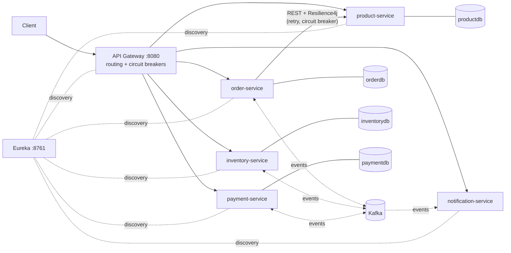
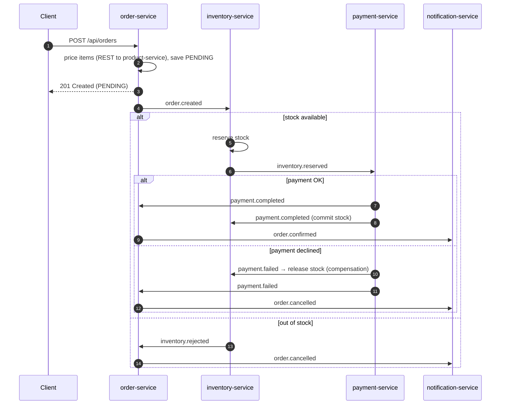

# 🛒 E-commerce Microservices: Spring Boot · Kafka · Saga

An event-driven e-commerce backend built with **Spring Boot 3.4 / Java 21**. It shows how to keep data consistent across services **without distributed transactions**, using the **choreography-based Saga pattern** over Apache Kafka.

    

## Architecture



| Service | Port | Responsibility |
|---|---|---|
| discovery-server | 8761 | Eureka service registry |
| api-gateway | 8080 | Single entry point, load balancing via `lb://`, circuit-breaker fallbacks |
| product-service | 8081 | Product catalogue (source of truth for prices) |
| order-service | 8082 | Starts the saga and owns the order lifecycle (`PENDING → CONFIRMED / CANCELLED`) |
| inventory-service | 8083 | Reserves, commits and releases stock |
| payment-service | 8084 | Simulated payment gateway (idempotent per order) |
| notification-service | 8085 | Sends (simulated) emails when the order is confirmed or cancelled |

Each service owns its own database (**database-per-service**), so nobody reads another service's tables.

## The Order Saga



## Run it

You need Docker with about **4 GB RAM** allocated. The first build takes a few minutes while Maven downloads dependencies.

```bash
docker compose up --build -d
docker compose ps            # wait until the services are running (~1 min)
```

| UI | URL |
|---|---|
| API Gateway | http://localhost:8080 |
| Eureka dashboard | http://localhost:8761 |
| Kafka UI (topics, messages, consumer lag) | http://localhost:8090 |
| Circuit breaker state | http://localhost:8082/actuator/circuitbreakers |

## Try the 4 saga scenarios

The full collection is in [`requests.http`](requests.http). Seed data: 5 products, with only **5 MacBooks** in stock, and a payment limit of **₹1,50,000**.

**1. Happy path → `CONFIRMED`**
```bash
curl -s -X POST localhost:8080/api/orders -H 'Content-Type: application/json' \
  -d '{"customerEmail":"asha@example.com","items":[{"skuCode":"IPHONE-15","quantity":1}]}'
```

**2. Out of stock → `CANCELLED` by inventory**
```bash
curl -s -X POST localhost:8080/api/orders -H 'Content-Type: application/json' \
  -d '{"customerEmail":"ravi@example.com","items":[{"skuCode":"MACBOOK-AIR","quantity":10}]}'
```

**3. Payment declined → `CANCELLED`, and the stock is released (compensation)**
```bash
curl -s -X POST localhost:8080/api/orders -H 'Content-Type: application/json' \
  -d '{"customerEmail":"meera@example.com","items":[{"skuCode":"MACBOOK-AIR","quantity":2}]}'
curl -s localhost:8080/api/inventory/MACBOOK-AIR   # available is back to 5, reserved 0
```

**4. Circuit breaker**
```bash
docker compose stop product-service
# send several orders: the first few retry, then the breaker OPENS and returns 503 instantly
curl -s localhost:8082/actuator/circuitbreakers
docker compose start product-service   # the breaker goes HALF_OPEN, then CLOSED
```

You can watch the results with `GET /api/orders/{id}`, `GET /api/payments` and `GET /api/notifications`, or check the event flow in Kafka UI.

## Design decisions (interview talking points)

**Why a saga instead of 2PC?** Two-phase commit locks resources across services and couples their availability. A saga runs a sequence of local transactions, and each failure triggers a *compensating action*: here, `payment.failed` releases the reserved stock.

**Why choreography?** Each service reacts to events, and there is no central coordinator. This keeps coupling low for a 3-step flow. The trade-off is that the flow is implicit, which is why the sequence diagram above matters. For longer flows, an orchestrator (a state machine in order-service) is easier to reason about.

**Idempotency (at-least-once delivery).** Kafka can redeliver messages, so every handler is safe to run twice:
- The order state only moves forward from `PENDING`, so a duplicate `confirm()` does nothing.
- `payments.order_id` is `UNIQUE`, so an order is never charged twice.
- Inventory checks for existing reservations before reserving.

**No overselling.** Inventory rows are locked with `PESSIMISTIC_WRITE`, ordered by SKU to avoid deadlocks, and the reservation is all-or-nothing.

**Ordering.** Every event is keyed by `orderId`, so all events for one order land on the same partition, in order.

**Failure handling.**
- *Sync calls:* the call to product-service is wrapped in Retry with exponential backoff, a CircuitBreaker, and timeouts. A 404 is a business error, so it is neither retried nor counted by the breaker.
- *Async calls:* a failed message is retried 3 times and then parked on `<topic>.DLT` (dead-letter topic) instead of blocking the partition.
- *Edge:* the gateway has circuit breakers with JSON fallback responses.

**Known trade-off: dual write.** A service commits to its database and then publishes to Kafka. If the service crashes in between, the event is lost. The production fix is the **Transactional Outbox pattern** (see the roadmap).

## Project structure

```
├── common/                 # shared event records, topic names, Kafka DLT config
├── discovery-server/       # Eureka
├── api-gateway/            # Spring Cloud Gateway
├── product-service/
├── order-service/          # domain/, client/ (Resilience4j), saga/, web/
├── inventory-service/
├── payment-service/
├── notification-service/
├── docker/postgres/init.sql
├── docker-compose.yml
└── Dockerfile              # one multi-stage Dockerfile, built per module (--build-arg MODULE)
```

## Run services from your IDE (optional)

```bash
docker compose up -d postgres kafka kafka-ui
mvn -pl discovery-server spring-boot:run      # then each service in its own terminal
```
The defaults (`localhost:5432`, `localhost:29092`, `localhost:8761`) work out of the box.

## Tests

```bash
mvn test
```

## Roadmap

- [ ] **Transactional Outbox** (outbox table + relay, or Debezium CDC) to remove the dual-write gap
- [ ] Orchestrated saga variant with a state machine, for comparison
- [ ] Flyway migrations instead of `ddl-auto=update`
- [ ] Integration tests with Testcontainers (Postgres + Kafka) covering every saga path
- [ ] Distributed tracing with Micrometer Tracing + Zipkin, and metrics with Prometheus + Grafana
- [ ] Security with Keycloak (OAuth2 resource servers and token relay at the gateway)
- [ ] Order timeout: auto-cancel orders stuck in `PENDING`
- [ ] Kubernetes manifests / Helm chart

## License
MIT
